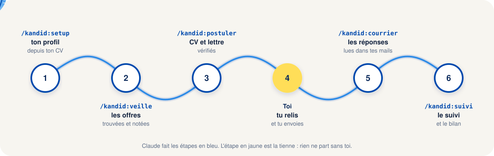
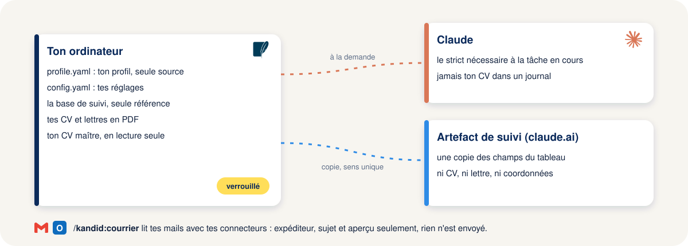

<h1 align="center">Kandid</h1>

<p align="center">
  <b>Alternance, stage ou premier emploi : Claude prépare tes candidatures, tu les valides et tu les envoies.</b>
</p>

<p align="center">
  <a href="https://github.com/sorooty/Kandid/actions/workflows/ci.yml"></a>
  &nbsp;
  <a href="https://claude.com/claude-code"></a>
  &nbsp;
  <a href="LICENSE"></a>
</p>

<p align="center">
  Un plugin pour <a href="https://claude.com/claude-code">Claude Code</a> qui cherche les offres, écrit un CV et une
  lettre fidèles à ton profil,<br>vérifie qu'ils passent les ATS et garde le suivi de chaque candidature, sur ta machine.
</p>


<p align="center">
  <a href="#démarrage-rapide"><b>Démarrage rapide</b></a>
  &nbsp;&nbsp;&nbsp;
  <a href="#commandes"><b>Commandes</b></a>
  &nbsp;&nbsp;&nbsp;
  <a href="#comment-se-prépare-une-candidature"><b>Une candidature, pas à pas</b></a>
  &nbsp;&nbsp;&nbsp;
  <a href="#tes-données"><b>Tes données</b></a>
  &nbsp;&nbsp;&nbsp;
  <a href="#réglages"><b>Réglages</b></a>
  &nbsp;&nbsp;&nbsp;
  <a href="#contribuer"><b>Contribuer</b></a>
</p>

> [!NOTE]
> Kandid est un projet open source indépendant. Il n'est ni affilié à Anthropic, ni soutenu ou maintenu par
> Anthropic. Claude et Claude Code sont cités pour décrire l'outil sur lequel Kandid s'appuie.

## Pourquoi Kandid

Je suis étudiant et je cherche une alternance en data. Comme beaucoup, j'ai vite eu trois problèmes : adapter un CV
et une lettre à chaque offre prend une soirée, les réponses des recruteurs se perdent entre les alertes d'offres et
les newsletters, et au bout de trente candidatures plus personne ne sait laquelle en est où.

Kandid est né de cette recherche. Il reprend les scripts que j'utilisais pour mes propres CV et en fait un outil
pour n'importe quel étudiant : Claude fait le travail de préparation, toi tu gardes la main sur ce qui part.



Trois règles ne bougent jamais :

- **Kandid prépare, tu envoies.** Il ne remplit aucun formulaire à ta place, n'envoie aucun mail et ne se connecte à
  aucun compte.
- **Rien n'est inventé.** Chaque compétence, chiffre ou expérience d'un CV ou d'une lettre doit venir de ton profil.
  Un contrôle automatique et un relecteur indépendant bloquent tout le reste.
- **Tes données restent chez toi.** Profil, CV, lettres et suivi vivent dans un dossier de ton ordinateur, jamais
  sur un serveur Kandid (il n'y en a pas).

## Ce que fait Kandid



Kandid se compose de trois briques :

- **le plugin Claude Code** : les commandes `/kandid:...`, un agent relecteur et des garde-fous (hooks) qui
  protègent ton CV maître et demandent ton accord avant tout envoi par un connecteur ;
- **l'outil `kandid`** : une ligne de commande Python qui fait tout ce qui doit être exact (recherche d'offres,
  rendu des PDF, score ATS, contrôle d'honnêteté, base de suivi), pour que Claude n'ait jamais à deviner ;
- **le suivi** : une base SQLite locale, que Claude affiche sous forme de tableau de bord dans un artefact.

Les offres viennent de La bonne alternance, de France Travail, d'Adzuna et des pages carrières des entreprises
(Greenhouse, Lever, Ashby, SmartRecruiters, Recruitee). Le marché visé est la France ; le fonctionnement, lui, ne
dépend ni du domaine ni du métier.

## Démarrage rapide

### Ce qu'il te faut

| | |
|---|---|
| **[Claude Code](https://claude.com/claude-code)** | Avec un abonnement Claude (Pro ou Max) ou des crédits API. |
| **[uv](https://docs.astral.sh/uv/)** | Lance l'outil `kandid` ; il installe lui-même la bonne version de Python. |
| **Une distribution LaTeX** | Avec `pdflatex` : [MiKTeX](https://miktex.org/) sous Windows, [TeX Live](https://tug.org/texlive/) ailleurs. |
| **[Poppler](https://poppler.freedesktop.org/)** | `pdftotext` et `pdfinfo`, pour lire les PDF comme un ATS. |

<details>
<summary>Clés d'API des sources d'offres (facultatives)</summary>

La bonne alternance, France Travail et Adzuna demandent une clé gratuite. `/kandid:setup` te dit quelles variables
d'environnement remplir et comment (`setx NOM valeur` sous Windows). Les clés ne passent jamais dans la conversation
ni dans un fichier du dépôt. Sans clé, la source est simplement ignorée ; les pages carrières n'en demandent pas.

</details>

### 1. Installer le plugin

Dans Claude Code :

```
/plugin marketplace add sorooty/Kandid
/plugin install kandid@kandid
```

### 2. Régler Kandid

```
/kandid:setup
```

Kandid te demande où ranger tes données, importe ton CV actuel section par section (tu valides chacune), puis
règle la recherche : contrats visés, ville et rayon, mots-clés, sources. Il propose enfin trois tâches planifiées
(veille le matin, relances, résumé du soir), que tu peux couper.

### 3. Chercher des offres

```
/kandid:veille
```

Les nouvelles offres sont dédoublonnées, comparées à ton profil et classées.

### 4. Préparer une candidature

```
/kandid:postuler https://exemple.fr/offres/alternance-data
```

Un lien, le texte de l'offre ou le numéro d'une offre trouvée par la veille. Tu obtiens un CV et une lettre en PDF,
le score ATS et les points à vérifier. L'envoi reste de ton côté.

> [!WARNING]
> Une offre est un texte écrit par un inconnu : Kandid ne suit aucune instruction qu'elle contient. Relis quand même
> ce qui a été produit avant d'envoyer, c'est ton nom en bas de la lettre.

## Commandes

| Commande | À quoi elle sert |
|---|---|
| **`/kandid:setup`** | régler Kandid, importer ton CV, programmer les tâches |
| **`/kandid:veille`** | chercher les nouvelles offres et les noter |
| **`/kandid:postuler`** | préparer une candidature complète, jusqu'au statut « Prêt » |
| `/kandid:cv`, `/kandid:lm` | refaire le CV ou la lettre d'une candidature |
| `/kandid:ats` | score ATS d'un CV, avec ou sans offre |
| `/kandid:formulaire` | remplir un formulaire en ligne à deux, sans le soumettre |
| `/kandid:suivi` | où en est chaque candidature et quoi faire ensuite |
| `/kandid:courrier` | lire les réponses des recruteurs et proposer les statuts |
| `/kandid:relance` | brouillons de relance pour les candidatures sans réponse |
| `/kandid:importer` | importer les candidatures envoyées avant Kandid |
| `/kandid:prep-entretien` | préparer un entretien |
| `/kandid:comparer` | comparer plusieurs offres |
| `/kandid:bilan` | bilan de la semaine |
| `/kandid:digest` | résumé du jour et actions du lendemain |
| `/kandid:taches` | voir, lancer ou couper les tâches planifiées |
| `/kandid:aide` | la liste des commandes et les règles |

<details>
<summary><b>Le détail des commandes de suivi</b></summary>

- **`/kandid:courrier`** lit tes mails de recruteurs avec le connecteur Gmail ou Microsoft 365 que tu as déjà dans
  Claude. Il écarte les alertes d'offres et les newsletters, reconnaît les refus, les demandes d'entretien et les
  accusés de réception, puis propose un changement de statut par réponse, daté du jour du mail. Rien ne change
  sans ton accord, et il n'envoie, ne déplace ni ne supprime aucun mail.
- **`/kandid:importer`** fait entrer les candidatures que tu as envoyées avant Kandid, avec leurs dates, depuis un
  fichier JSON. Le relancer ne crée pas de doublon.
- **`/kandid:relance`** repère les candidatures restées sans réponse et écrit des brouillons courts, fondés sur ce
  que tu as réellement envoyé. Tu les envoies toi-même.
- **`/kandid:bilan`** compte les envois, les réponses et les délais de la semaine, et pointe ce qui coince.

</details>

## Comment se prépare une candidature



1. **L'offre** est enregistrée (lien, texte collé ou numéro de veille), puis résumée dans une fiche avec
   l'adéquation à ton profil en cinq lignes. Si un prérequis manque, Kandid te demande s'il faut continuer.
2. **Le CV et la lettre** sont rédigés à partir de ton `profile.yaml` uniquement, puis rendus en PDF avec LaTeX.
3. **Le contrôle d'honnêteté** compare chaque compétence citée à ton profil. Une compétence absente bloque le rendu :
   on corrige le CV, jamais le profil.
4. **Le score ATS** lit le PDF comme le ferait un logiciel de recrutement et mesure la couverture des mots-clés de
   l'offre. Un mot-clé que ton profil justifie est ajouté ; un mot-clé qu'il ne justifie pas reste manquant.
5. **Un relecteur indépendant**, un second agent qui n'a pas écrit les documents, les relit comme un recruteur
   exigeant et vérifie chaque affirmation. Tant qu'il signale un point bloquant, on reprend.
6. **La candidature passe à « Prêt »** avec ses deux PDF classés. `/kandid:formulaire` peut t'aider à remplir le
   formulaire en ligne, mais c'est toi qui cliques sur « Envoyer ».

## Tes données

| Où | Quoi |
|---|---|
| **Ton dossier de données** (par défaut `~/.kandid`) | profil, réglages, base de suivi, rapports, journaux |
| **Ton dossier de candidatures** | les CV et lettres en PDF, un dossier par candidature |
| **Ton dossier de CV maître** | lu, jamais modifié : un hook bloque toute écriture |
| **Claude** | le strict nécessaire à la tâche en cours, jamais le contenu de ton CV dans un journal |



Le tableau de bord du suivi est un artefact Claude : une page privée sur ton compte claude.ai, qui affiche une copie
des champs du tableau (entreprise, poste, statut, dates, prochaine action). La base de ton ordinateur reste la seule
référence ; ni CV, ni lettre, ni coordonnées n'y sont copiés.

Les tâches planifiées tournent sur ton ordinateur, avec un budget plafonné par exécution (0,50 USD et 30 tours par
défaut). Elles préparent, elles n'envoient jamais rien.

## Réglages

Tout se règle dans `config.yaml`, dans ton dossier de données. `/kandid:setup` le remplit ; tu peux ensuite le
modifier à la main ou relancer `/kandid:setup` pour changer une seule partie.

| Section | Ce qu'elle règle |
|---|---|
| `paths` | dossiers de données, de candidatures et de CV maître |
| `watch` | contrats, zone, mots-clés et mots exclus, sources d'offres activées |
| `tasks` | heures et activation des tâches planifiées |
| `mail` | période lue par `/kandid:courrier`, alertes à ignorer, mots qui signalent un refus ou un entretien |

Une alerte d'offres que Kandid ne reconnaît pas encore ? Ajoute son expéditeur à `mail.ignore_senders` : aucune
modification de code n'est nécessaire.

## Développer Kandid

Prérequis : Python 3.11 ou plus avec [uv](https://docs.astral.sh/uv/), Node.js 24 et pnpm.

```bash
pnpm install
uv sync
pnpm check                  # lint et tests
claude --plugin-dir .       # essayer le plugin depuis le dépôt
```

Les choix de conception sont expliqués dans [docs/adr](docs/adr), à partir de
l'[ADR 0011](docs/adr/0011-local-first-plugin-and-crm.md), et chaque fonctionnalité a sa spec dans
[docs/specs](docs/specs). Le profil fictif de « Camille Martin » dans [examples](examples) sert aux tests et aux
démonstrations.

## Contribuer

Les idées, les retours et les contributions sont les bienvenus. Pour proposer une fonctionnalité, commencez par
ouvrir une [discussion](https://github.com/sorooty/Kandid/discussions), puis préparez une pull request courte une
fois le besoin clarifié. Consultez le [guide de contribution](CONTRIBUTING.md) pour connaître la charte et les
vérifications à effectuer.

## Sources et remerciements

- [ai-job-search](https://github.com/ai-job-search-dev/ai-job-search) (MIT), framework de candidature sur Claude
  Code, qui a inspiré la séparation entre rédacteur et relecteur.
- [job-hunt-kit](https://github.com/Tedywarhol/job-hunt-kit), pour les idées de contrôle du ton, de couverture des
  mots-clés et d'utilisation des API publiques des ATS.
- La [documentation de Claude Code](https://code.claude.com/docs) (plugins, hooks, skills, mode non interactif).
- Les API publiques de [La bonne alternance](https://api.apprentissage.beta.gouv.fr), de
  [France Travail](https://francetravail.io) et d'[Adzuna](https://developer.adzuna.com).

La liste complète des sources consultées, avec ce que chacune a apporté, est dans [SOURCES.md](SOURCES.md).

## Licence

[MIT](LICENSE)


